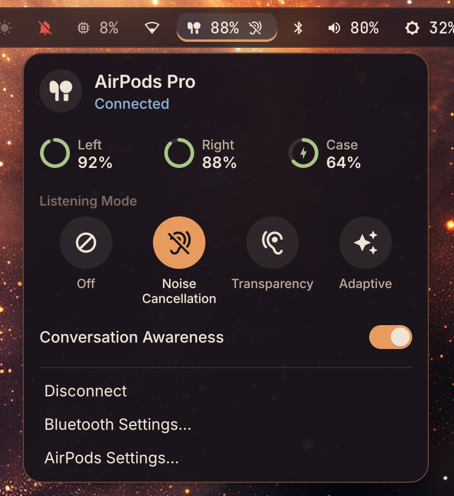
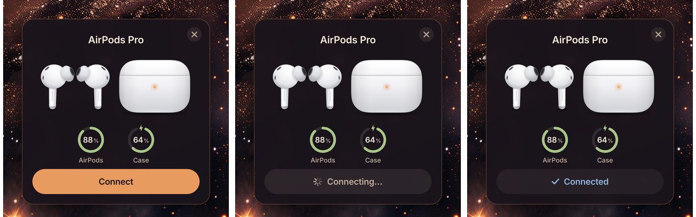
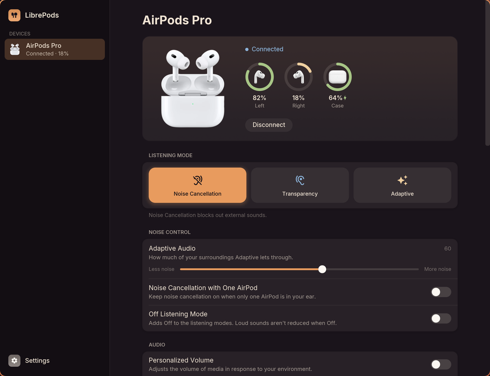
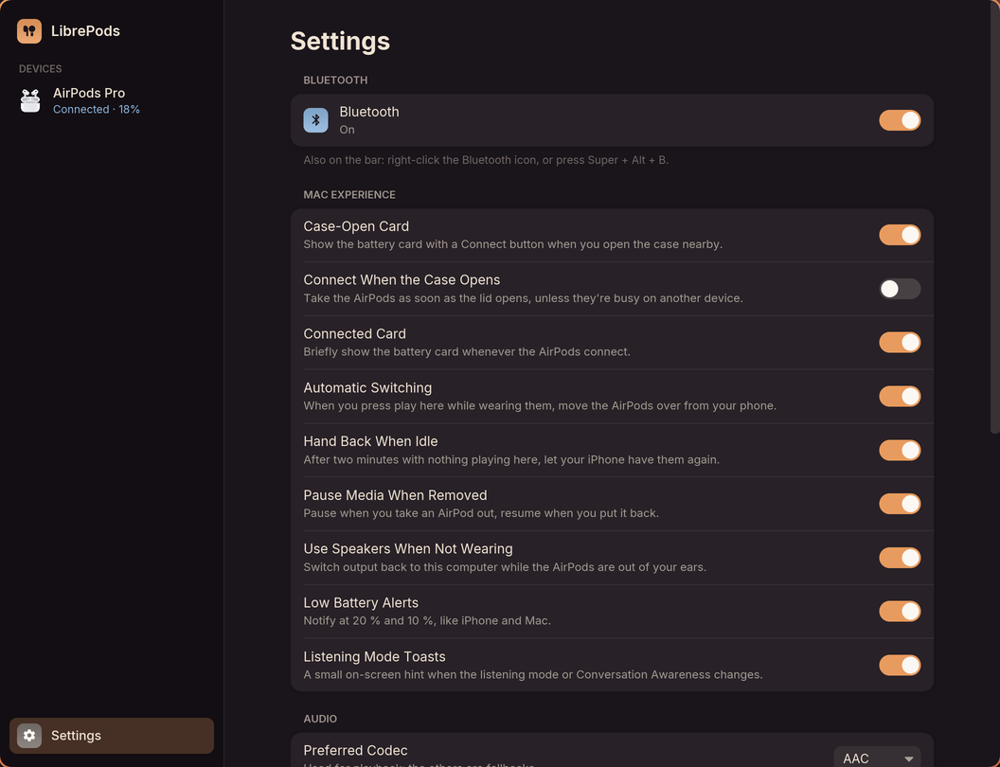
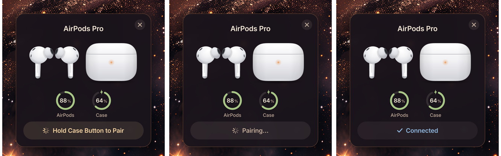

<h1 align="center">AirPods on Linux, the Mac way</h1>

<p align="center">
AirPods Pro on a Linux Wayland desktop with the feel of a Mac: the case-open card,<br>
a menu-bar dropdown, battery and listening modes in Waybar, switching with your iPhone,<br>
and a pairing that repairs itself when the AirPods forget this computer.
</p>

<p align="center"></p>

It is two pieces:

* **[LibrePods](https://github.com/librepods-org/librepods)'s Linux app, from the
  [`macfeel` branch of my fork](https://github.com/B-Divyesh/librepods/tree/macfeel)**
  (a git submodule here). It talks to the AirPods over Apple's control protocol
  (AACP) and reads their Bluetooth LE broadcasts.
* **This repo:** the installer, the BlueZ setup, an optional dual-boot key sync,
  and drop-in configs for Waybar, Hyprland, sway and mako.

Built and used on Arch Linux with Hyprland 0.56, Waybar, BlueZ 5.87, PipeWire and
AirPods Pro 2 (USB-C) on firmware 9A348 (build 9442752). Other AirPods models that
LibrePods supports should work too.

---

## What you get

| On a Mac / iPhone | Here |
|---|---|
| Open the case: a card with each bud's battery | The same card on a Wayland layer-shell surface, with a **Connect** button (or connect by itself) |
| AirPods in the menu bar | A Waybar pill with live battery and the listening mode as a coloured underline; click it for the dropdown |
| Control Center listening modes | Noise Cancellation, Transparency, Adaptive and Off from the dropdown, the window, right-click on the pill or a keybind |
| System Settings → AirPods | A settings window in the same style: modes, adaptive strength, press-and-hold, ear detection, mic side, Conversation Awareness and more |
| Automatic switching with your iPhone | **Handoff:** press play here and they come over; leave them idle and they go back to the phone ([details](#switching-between-iphone-and-this-computer)) |
| "Connect to iPhone" after a reset | When they forget this computer, the card says so and **re-pairs by itself** as soon as you hold the case button |
| Low-battery alerts, mode HUDs | mako notifications and small OSD toasts |
| | High-quality mic (AACP audio, upstream PR #655), A2DP codec choice (#766), dual-boot key sync |

<table>
<tr>
<td></td>
<td><br><br>
</td>
</tr>
</table>

<p> </p>

<sub>All screenshots come from the [simulator](#testing-without-airpods) (fake AirPods driving the real UI), so the battery levels are sample data.</sub>

## Why not "act as an Apple device"?

LibrePods can make Linux report Apple's Bluetooth vendor ID
(`DeviceID = bluetooth:004C:0000:0000` in BlueZ). AirPods then treat the computer
as an Apple device, which unlocks multipoint and a few Apple-only settings. I ran
it that way for a while, and then stopped:

* Apple's automatic switching is an iCloud feature. Devices on the same Apple ID
  share a key for the AirPods and derive a fresh link key on every connection
  ([MagicPairing, Heinze et al., WiSec '20](https://arxiv.org/abs/2005.07255)).
  A Linux machine can only hold an ordinary Bluetooth link key.
* Firmware **9A348** (September 2026) drops hosts that claim Apple's vendor ID
  but don't complete Apple's session setup, about 40 s into each session
  ([librepods#782](https://github.com/librepods-org/librepods/issues/782)).
  On my AirPods the host status flipped on and off every 6 s and the iPhone took
  them within half a minute. They also kept **forgetting this laptop** after being
  used with the iPhone, so every reconnect failed with `br-connection-key-missing`.

So the default here is a **plain Bluetooth host**. The pairing stays put, and the
switching is done by LibrePods' handoff. Battery, listening modes, ear detection
and the other settings work either way. `sudo ./system/setup-bluez.sh --apple-id`
brings the vendor ID back for older firmware.

## Requirements

* BlueZ with `Experimental = true` (set by `system/setup-bluez.sh`), PipeWire with
  pipewire-pulse, systemd.
* A compositor with **wlr-layer-shell** for the card and the dropdown: Hyprland,
  sway, river, niri, Wayfire or KDE. On GNOME you get the window and the tray icon.
* To build: Rust ≥ 1.89 (`rustup`), clang, pkg-config, and the dbus, libpulse and
  ffmpeg development packages. `install.sh` lists them per distro if any are missing.
* Fonts used by the UI: Inter, plus JetBrainsMono Nerd Font for the bar glyphs.

## Install

```sh
git clone --recursive https://github.com/B-Divyesh/airpods-macfeel
cd airpods-macfeel
./install.sh                     # builds LibrePods + the card, installs to ~/.local, starts the service
sudo ./system/setup-bluez.sh     # once: FastConnectable, Experimental, plain host (backs up main.conf)
```

The build takes a few minutes the first time. `install.sh` refuses to start on
battery unless you set `FORCE=1`.

Then wire it into your desktop. Each file says where it goes:

| | |
|---|---|
| Autostart + keybinds + window/layer rules | [`config/hyprland/airpods.lua`](config/hyprland/airpods.lua) (Hyprland ≥ 0.55), [`airpods.conf`](config/hyprland/airpods.conf) (≤ 0.54), [`config/sway/airpods.conf`](config/sway/airpods.conf) |
| Waybar module | [`config/waybar/airpods.jsonc`](config/waybar/airpods.jsonc) + [`airpods.css`](config/waybar/airpods.css) |
| Notifications | [`config/mako/airpods.ini`](config/mako/airpods.ini) |

Pair the AirPods once, from your Bluetooth settings or with `airpods-repair`
(case open, hold the button on the back until the light flashes white).

## Switching between iPhone and this computer

Apple's own switching needs the same Apple ID on both devices, so a Linux machine
can't be part of it. This is the closest a plain Bluetooth host can get, without
pretending to be Apple:

* **Press play here** while you're wearing the AirPods, and they come over from the
  phone. Playback is paused until they're connected, so nothing comes out of the
  laptop speakers. Their Bluetooth LE broadcast says what they're doing on the
  other device, so nothing is taken during a call.
* **Leave them idle here.** After two minutes with nothing playing through them
  (music, a call or the mic), they're handed back, and the iPhone picks them up
  again.
* **On the iPhone**, set Settings → [AirPods] → *Connect to This iPhone* to
  **Automatically**. To have opening a music app pull them over straight away,
  add a Shortcuts automation:
  1. In Shortcuts, go to Automation → New Automation → **App**.
  2. Pick Music, Spotify, YouTube and Podcasts, choose *Is Opened*, and set it to *Run Immediately*.
  3. Add the action **Set Playback Destination** and choose your AirPods.

Both directions are switches in the settings window under *Automatic Switching* and
*Hand Back When Idle*. The delay is `hand_back_after_secs` in
`~/.config/librepods/app_settings.json`.

> Status: handoff is new (October 2026). Its logic is covered by unit tests and the
> simulator; how quickly the iPhone reclaims the AirPods after a hand-back is up to
> iOS.

## Can't I just have real Apple switching? (firmware 9A348)

Short answer: not cleanly, and not by logging in. Apple's instant switching is an
**iCloud** feature — devices on one Apple ID share the AirPods key through iCloud
Keychain, which is gated by Apple's **Octagon** trust system and the Secure
Enclave. A Linux box can't join that from the outside, no matter who's signed in,
and nobody has. ([MagicPairing, WiSec '20](https://arxiv.org/abs/2005.07255) has
the gory details.)

The *other* kind — the vendor-ID multipoint LibrePods implements — needs no Apple
account and used to work. On **firmware 9A348 (build 9442752, Sept 2026)** the
AirPods drop a vendor-ID host about 40 seconds into each session
([librepods#782](https://github.com/librepods-org/librepods/issues/782)). That's a
protocol problem, not a login problem, and it's the one worth chasing.

This fork ships the tools to chase it. **None of this needs your Apple account, and
nothing here can give you Apple's iCloud switching** — it's for making the
vendor-ID path survive on the new firmware.

### Capture what your AirPods actually do

```sh
# plain host first, to confirm the tooling (stable, no risk):
systemctl --user stop librepods
LIBREPODS_AACP_TRACE=/tmp/aacp.log librepods --no-tray &
librepods ctl connect              # use them a bit, then Ctrl-C the daemon
python3 librepods/linux-rust/tests/sim/aacp_decode.py /tmp/aacp.log
```

The daemon writes one labelled line per control-channel frame. **It masks the BLE
keys, the serial numbers, the device name and the Bluetooth addresses before
writing** (see `src/bluetooth/trace.rs`), so the file is safe to attach to an
issue — but read it first anyway. `aacp_decode.py` labels every frame, times the
session, and points out the things #782 is about. Run it with `--self-test` to see
it work with no hardware.

To see the ~40s drop itself you need a capture in Apple-Device-ID mode:

```sh
sudo ./system/setup-bluez.sh --apple-id      # expect drops/forgotten pairing here
# capture as above; when done, go back to the stable setup:
sudo ./system/setup-bluez.sh                 # plain host again
```

### Try the experimental fix

The core handshake already matches macOS; the suspects are two extra packets we
send afterward. `LIBREPODS_AACP_STRICT=1` sends **only** the documented
third-party sequence (handshake → host-capabilities `0x4D` → notifications `0x0F`)
and skips them:

```sh
systemctl --user stop librepods
LIBREPODS_AACP_STRICT=1 LIBREPODS_AACP_TRACE=/tmp/strict.log librepods --no-tray &
```

Capture with and without it in `--apple-id` mode and compare how long the link
lasts. (Trade-off while strict: BLE address resolution doesn't refresh until the
next reconnect, so nearby/battery-from-broadcast can lag.) **This is a hypothesis,
not a proven fix** — if it helps on your firmware, please say so on #782 and attach
the two decoded traces.

## When the AirPods forget this computer

AirPods sometimes drop their half of the pairing: after a reset, after the other OS
of a dual boot paired them, or on their own. Every connect then fails with
`br-connection-key-missing`, and only pairing again helps. Instead of an error:

<p></p>

1. The card, the bar pill (gold) and a notification ask you to **hold the button on
   the back of the case** until the light flashes white.
2. LibrePods notices the case in pairing mode and drops the stale pairing. It then
   pairs with its own agent, trusts and reconnects the AirPods.
3. If nothing happens within three minutes, the card offers **Try Again**.

You can also run `librepods ctl repair` (and `librepods ctl repair cancel`) or
`airpods-repair` yourself.

## Using it

| | |
|---|---|
| Waybar pill | left click: dropdown · right: next listening mode · middle: connect/disconnect · scroll: Conversation Awareness |
| `Super + Alt + A` | next listening mode |
| `Super + Alt + Shift + A` | connect / disconnect |
| `Super + Alt + C` | Conversation Awareness on/off |
| `Super + Alt + P` | battery card |
| `Super + Ctrl + A` | settings window |
| `Super + Alt + B` | Bluetooth on/off |

```text
librepods ctl status | watch | waybar
librepods ctl mode off|anc|transparency|adaptive|next
librepods ctl ca on|off|toggle
librepods ctl connect | disconnect | toggle | repair [cancel]
librepods ctl bluetooth on|off|toggle
librepods ctl open | popup | menu
```

## Dual boot with Windows

Both systems use the same Bluetooth address, and AirPods keep only one key per
address, so pairing them in one OS breaks the other. The optional key sync runs
before `bluetoothd` on every boot. If Windows has paired them since the last boot,
it copies Windows' key into BlueZ:

```sh
sudo ./system/dualboot/install.sh      # finds the Windows partition; or --part /dev/…
```

* The Windows partition is mounted read-only and never written.
* Recent registry writes are read from the hive's transaction logs, which is where
  a fresh pairing usually is.
* The sync only imports a key when Windows' key has changed since the last boot, so
  a newer Linux pairing is never overwritten.
* It works in one direction. Pair in Windows, and Linux follows on the next boot.
  Pair in Linux, and Windows needs pairing again.
* It can't read BitLocker-encrypted partitions.

## Testing without AirPods

`linux-rust/tests/sim/` in the fork:

| | |
|---|---|
| `run_sim.py` | runs the real daemon against a mocked BlueZ (python-dbusmock) with fake AirPods that can forget the host, enter pairing mode or refuse a pair. Ten scenarios cover the re-pairing flow end to end. |
| `ui_sim.py` | stands in for the daemon and plays scenarios (tour, repair, handoff) into the real card, dropdown and Waybar module |
| `aacp_decode.py` | reads an `LIBREPODS_AACP_TRACE` capture and labels it (see [firmware 9A348](#cant-i-just-have-real-apple-switching-firmware-9a348)); `--self-test` needs no hardware |
| `screenshots.sh` | regenerates the screenshots in this README (Hyprland) |

```sh
cd librepods/linux-rust
cargo test --release && (cd popup && cargo test --release)
pip install python-dbusmock && python3 tests/sim/run_sim.py
```

## Troubleshooting

* **`br-connection-key-missing` / "Couldn't connect":** the AirPods forgot this
  computer. Hold the case button when the card asks. See above.
* **Pairing says `InProgress` or fails at once:** BlueZ needs a pairing agent, and
  a bare `bluetoothctl pair` has none. Use `librepods ctl repair` or `airpods-repair`.
* **No card when the lid opens:** check that `bluetoothctl show` lists
  `AdvertisementMonitorManager1` features (that's `Experimental = true`, set by
  `setup-bluez.sh`), and that your compositor supports layer-shell.
* **Sound stays on the speakers:** pick the AirPods as the output once in
  pavucontrol, since WirePlumber remembers the choice. The preferred codec is in
  the settings window.
* **Logs:** `journalctl --user -u librepods -f`. The AirPods' keys are never logged.

## Uninstall

```sh
./uninstall.sh [--purge]               # binaries, service, desktop entry (+ settings)
sudo ./system/setup-bluez.sh --revert  # main.conf as it was before
sudo ./system/dualboot/uninstall.sh    # if you installed the key sync
```

## How it works

```text
AirPods ──AACP (L2CAP 0x1001)──┐                      ┌─ librepods-popup  card + dropdown (layer-shell)
        ──BLE broadcasts───────┤  librepods daemon    ├─ librepods ctl waybar  → Waybar pill
                               │  hub · repair ·      ├─ librepods ctl …       → keybinds, scripts
BlueZ (D-Bus) ─────────────────┘  handoff · notify    └─ settings window (iced)
                                       │
                         $XDG_RUNTIME_DIR/librepods.sock (JSON lines)
```

## Credits

* [LibrePods](https://github.com/librepods-org/librepods) by Kavish Devar and
  contributors: the protocol work and the Linux app this builds on.
* Merged upstream pull requests: #655 (hi-res mic) by Luan Ademi, #766 and #775 by
  injkgz, #724 by RamfiAogusto.
* The card's rendering is ported from [podctl](https://github.com/Rockykln/podctl)
  (MIT or Apache-2.0).
* Handshake and opcode documentation from upstream
  [PR #797](https://github.com/librepods-org/librepods/pull/797) and
  [pabloaul/apple-wireshark](https://github.com/pabloaul/apple-wireshark).
  The broadcast connection-state values follow [CAPod](https://github.com/d4rken-org/capod).

## License

GPL-3.0 (this repo). The LibrePods fork keeps upstream's license. Not affiliated
with Apple; AirPods is a trademark of Apple Inc.
